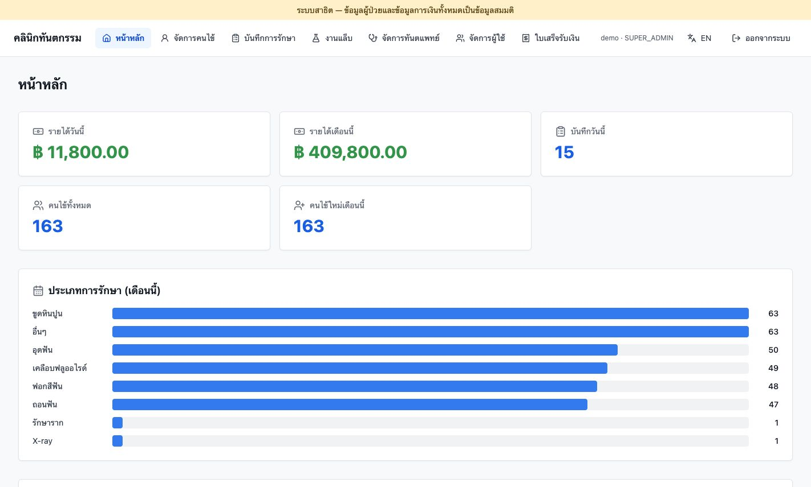
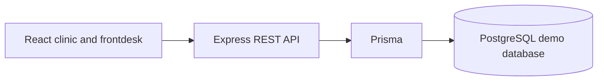

# Dental Clinic — Full-stack Portfolio

A React and Express application for fictional dental-clinic workflows: patient records, treatment history, appointments, receipts, lab work and role-based access. The portfolio copy uses generic branding and an isolated PostgreSQL demo database.

## Live demo

[Open the Clinic demo](https://stoem21.github.io/clinic-portfolio/)

The public demo signs visitors in automatically and uses fictional patient and financial records in an isolated database. The backend runs on a Mac through an HTTPS tunnel, so interactive features are available while the host and tunnel are online.



*Screenshot of the demo dashboard; all patient and financial figures are synthetic.*

> **Frontdesk status:** The frontdesk module has not yet been used in live clinic operations. It is included for demonstration; end-to-end workflow validation is still pending.

| Layer | Technologies |
| --- | --- |
| Frontend | React 19, TypeScript, Vite 8, Tailwind CSS, Radix UI |
| Application state and forms | Zustand, React Router, React Hook Form, Zod, Axios |
| Backend | Node.js 22, Express 5, TypeScript, JWT, optional TOTP |
| Persistence | PostgreSQL 16, Prisma 6, migrations |
| Delivery | Docker Compose; optional GitHub Pages frontends and ngrok-hosted APIs |

## Features to explore

- Patient and dentist management, treatment records and payment categories.
- Frontdesk demo: appointment scheduling, follow-up calls and lab jobs (not yet used in live clinic operations).
- Receipts and printable documents using a fictional demo letterhead.
- Role checks, audit events, soft deletion and restoration.
- Thai/English interface support.

## Engineering highlights

- **Relational workflows:** Patient, treatment, receipt, lab-work and appointment records are connected through a PostgreSQL schema managed with Prisma migrations.
- **Access and traceability:** Express middleware enforces role checks, while audit events record changes. Soft deletion and restoration support recoverable record management.
- **Isolated demonstration:** Demo initialization uses a separate database with synthetic records, generated local secrets and automatic visitor login. Production patient imports and database dumps are excluded.
- **Thai/English address entry:** The address picker loads geographic reference data on demand and supports cascading province, district, subdistrict and postal-code selection.

## My contribution

I developed this as a solo project with AI coding assistance. My work covers the clinic workflows, React interface, Express API, Prisma/PostgreSQL data model and the integration of patient, treatment, appointment and receipt features.

For this public portfolio, I also prepared the isolated demo, synthetic records, API connection and deployment configuration. AI tools assisted with implementation, debugging, tests and documentation. The [validation scope](docs/VALIDATION.md) describes completed checks and remaining end-to-end work; the frontdesk module has not yet been used in live clinic operations.

## Run a fresh local demo

Requires Docker Desktop. From this repository root:

```bash
python3 scripts/setup-demo.py
docker compose up -d --build
```

Open `http://localhost:4101`; the frontdesk is `http://localhost:4101/frontdesk/`. The username is `demo`; read `DEMO_PASSWORD` locally in the generated `.env`. The setup helper creates random local secrets and refuses to overwrite an existing `.env`.

The Compose project is `clinic-portfolio`, with its own database volume. Initialization accepts only `DEMO_MODE=true` and `clinic-db/clinic_demo`; it refuses an existing unmarked database. Restarting retains demo edits. Automatic visitor login is enabled by default (`DEMO_AUTO_LOGIN=true`). Visitors receive the demo account permissions in the isolated demo database. Daily fixture generation remains disabled. The setup script preserves an existing `.env`; set `DEMO_AUTO_LOGIN=true` there if it was created earlier, then recreate the demo app container.

```bash
docker compose stop
```

## Architecture



## GitHub Pages with a backend on a Mac

See [deployment configuration](docs/DEPLOYMENT.md). The frontend build supports `VITE_API_BASE_URL`, a project-site base path and hash routing for Pages. Backend runtime configuration, credentials, patient imports and database dumps are excluded.

## Validate

```bash
cd backend
npm ci
npx prisma generate
npm run build
npm test
```

In a separate terminal:

```bash
cd frontend
npm ci
npm run build
npm run build:frontdesk
```

See [validation scope](docs/VALIDATION.md) for completed checks and workflows that still need end-to-end validation.

## Source and attribution

This public demo uses generic branding, synthetic fixtures and an isolated PostgreSQL database. Production patient records, credentials and database dumps are excluded.

The Thai address picker includes an unchanged copy of the geographic reference data from [GeoThai](https://github.com/GeoThai/npm-packages), npm package `geothai` version 3.0.1. Source details and the MIT notice shipped with that package are preserved in [third-party notices](THIRD_PARTY_NOTICES.md).

This repository does not include an open-source license for the application. Third-party components retain their own licenses.
